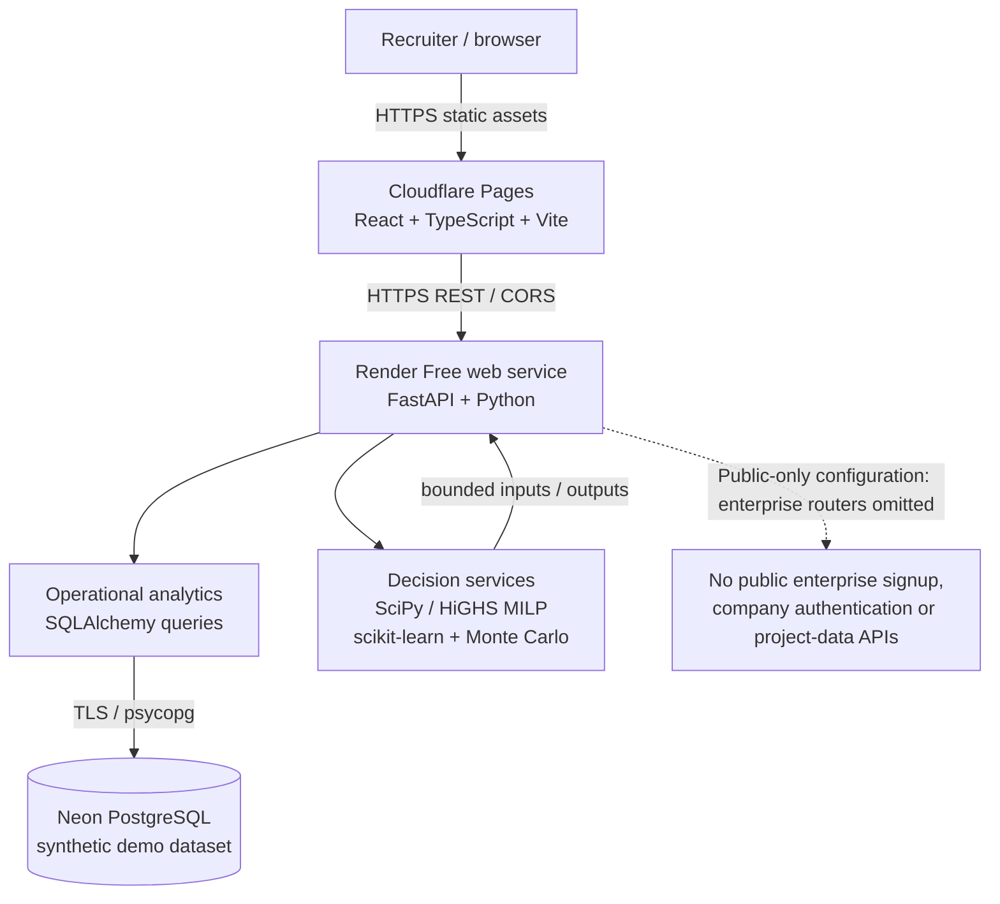

# OpsIntelligence

**Operational intelligence, mathematical optimisation and scenario analysis — from operational data to explainable decisions.**

[**Launch live demo**](https://opsintelligence.pages.dev) · [Architecture](docs/architecture.md) · [Recruiter walkthrough](docs/recruiter-demo.md) · [Deployment and security verification](docs/public-deployment-verification.md)

OpsIntelligence is a full-stack software engineering portfolio project for exploring warehouse operations, testing constrained decisions and comparing hypothetical scenarios. It combines an interactive React/TypeScript interface, a Python/FastAPI API, PostgreSQL data models, mixed-integer linear programming (MILP), machine-learning evaluation and Monte Carlo simulation.

**Public demo:** Free-hosted, no account required, synthetic data only. **Local enterprise prototype:** Separate authenticated company/project workflows that are **not deployed publicly**. The two experiences intentionally have different security and feature scopes.

> **Engineering contract:** Solver optimality applies only to the stated mathematical formulation and assumptions. Scenario differences are *modelled*, not audited or realised cost savings. Industry examples are bounded prototypes, not production-scale solvers. The project is not certified for confidential enterprise data.

## Try it online

**[https://opsintelligence.pages.dev](https://opsintelligence.pages.dev)**

A suggested five-minute walkthrough:

1. **Overview:** Inspect order volume, pending workload, inventory and delivery KPIs generated from synthetic warehouse records.
2. **Business intelligence / Operational orders:** Explore trends, filters, order details and operational signals.
3. **Optimisation:** Modify handling constraints and examine the solver's proposed allocation, objective and assumptions.
4. **Industry solver lab:** Compare bounded optimisation examples across logistics, agriculture and technology.
5. **Scenario analysis / Delay predictions:** Examine sensitivity, uncertainty and evaluation metrics rather than treating forecasts as guarantees.

The demonstrated baseline dataset contains **240 synthetic orders**, including 68 pending orders, 172 delivered orders, 31 recorded late deliveries and an **81.98% on-time rate**. These are *demo data*, not results achieved for a customer. They may change if the synthetic dataset is updated.

> Free-tier hosting can cause a slow first API request after inactivity. This is a hosting constraint, not an indication that results were precomputed or a guarantee of uptime.

## Capabilities and boundaries

| Area | Implemented capability | What it does **not** imply |
| --- | --- | --- |
| Operational analytics | Warehouse KPIs, time trends, order explorer, synthetic alert signals | Live production warehouse integration |
| Warehouse optimisation | Constraint-based dispatch/allocation models with SciPy/HiGHS and explicit objective assumptions | Real-world optimality across every physical constraint |
| Industry solver pilots | Small MILP examples for logistics, agriculture and technology | Production-grade multi-industry optimisation engines |
| ML and simulations | Delay-prediction evaluation and Monte Carlo/what-if comparisons | Validated forecasting or guaranteed financial outcomes |
| Enterprise workspace (local only) | Organisations, projects, roles, invitation onboarding, audit records and bounded CSV import | Public production-ready identity or tenant-security certification |
| Engineering and delivery | REST APIs, validation, SQLAlchemy, Alembic, Docker, CI and automated tests | A formal external security or performance audit |

## System architecture



**Two deployment profiles:**

- **Public recruiter demo:** Cloudflare Pages frontend, Render FastAPI Docker container and dedicated Neon PostgreSQL. `VITE_PUBLIC_DEMO_ONLY=true`, `OPS_PUBLIC_DEMO_ONLY=true` and server-side route restrictions separate the public experience from local enterprise workflows. The public API rejects enterprise authentication requests and public demo reseeding. CORS is restricted to the Pages origin.
- **Local enterprise prototype:** Docker Compose / PostgreSQL with the full React/FastAPI application, company/project workflows, scoped CSV data, invitations, role-based authorisation and saved project optimisation runs. This environment is for demonstration and local testing, **not** public exposure or real client credentials.

See [architecture and trust boundaries](docs/architecture.md) for component responsibilities, data flow, API security limitations, delivery automation and trade-offs.

## Technical stack

| Layer | Technologies |
| --- | --- |
| Frontend | React, TypeScript, Vite, responsive component UI |
| Backend | Python, FastAPI, Pydantic, REST APIs |
| Data | PostgreSQL 16, SQLAlchemy, psycopg, Alembic |
| Decision intelligence | SciPy / HiGHS MILP, scikit-learn, Monte Carlo simulations |
| Local infrastructure | Docker, Docker Compose, Nginx reverse proxy |
| Public hosting | Cloudflare Pages, Render Free, Neon Free |
| Quality / delivery | pytest, Vitest, ESLint, TypeScript compilation, GitHub Actions |

## Testing and verification

Latest locally reported checks at deployment preparation:

- **Backend:** 64 tests passed.
- **Frontend:** 21 tests passed; lint and production build passed.
- **CI:** GitHub Actions checks passed for the public deployment PR.
- **Public smoke checks:** Render and Cloudflare successfully deployed; public operational overview and industry catalogue returned JSON; company authentication URL returned the public-demo restriction; the frontend displayed API-backed synthetic KPIs.

These checks are meaningful but **not** external penetration testing, exhaustive solver benchmarking or continuous uptime monitoring.

```powershell
# Frontend validation
cd frontend
npm ci
npm run lint
npm run build
npm test

# Backend (from repository root, with a local Python venv installed)
cd ..\backend
.\.venv\Scripts\python.exe -m pytest -q
```

## Local development

**Prerequisites:** Docker Compose, Python and Node.js/npm for development, or Docker for the full-stack local build. No paid APIs are required.

```powershell
# Repository root
Copy-Item .env.example .env # only if .env doesn't already exist
# Set a unique local POSTGRES_PASSWORD in .env
docker compose -f compose.full.yaml up -d --build
docker compose -f compose.full.yaml ps -a
```

Open **http://127.0.0.1:8080** for the local Docker frontend. Keep local `.env` files, credentials and invitation codes outside version control. **Do not run `docker compose down -v` unless intentionally deleting local PostgreSQL data.**

## Data and model integrity

- All publicly demonstrated order data is synthetic. Linked external data sources in the industry catalogue are *research references*, not proof of live ingestion.
- The warehouse optimisation objective considers defined capacity and penalty/cost assumptions; it does not fully model routing, labour scheduling or all inventory constraints.
- A solver result labelled **optimal** means optimal within the encoded model and solver status—not the single globally best decision for any business.
- Monte Carlo outputs and ML assessments illustrate model behaviour and uncertainty; they are not validated operating forecasts.
- Do not interpret reductions in hypothetical defer penalties as realised revenue or profit.

## Security and cost disclosures

The public API uses a separate deployment configuration and excludes enterprise/authentication, connector and private-project routes. It also blocks demo reseeding and applies a basic per-process computation throttle. These are **defence-in-depth measures, not proof of production security**. Email verification, MFA, independent audit, robust abuse protection and per-project enterprise hardening are outside the demonstrated release scope.

The project currently uses free-plan hosting with no mandatory paid subscriptions. Free plans have usage limits, cold starts and availability trade-offs; ongoing operation and zero future charges are not guaranteed by the project itself. Do not upgrade hosting to solve a capacity problem without reviewing the cost.

## Documentation

- [System architecture and data flow](docs/architecture.md)
- [Recruiter demo walkthrough](docs/recruiter-demo.md)
- [Public release verification](docs/public-deployment-verification.md)
- [Free-tier deployment guide](docs/public-zero-cost-deployment.md)
- [Mathematical optimisation contract](docs/phase4e-final-optimisation-and-security.md)
- [Private project CSV workflow](docs/phase4e2-private-csv-workspace.md)
- [Employee invitation workflow](docs/phase4e3-employee-invitations.md)
- [Resume project description](docs/resume-project-entry.md)

**Built as a demonstrable full-stack engineering and decision-intelligence platform—not a claim of universal business optimisation.**
