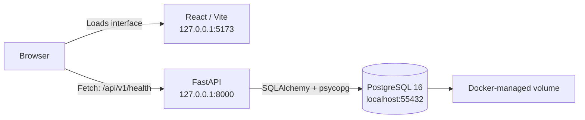

# Architecture

OpsIntelligence uses a React frontend, a single FastAPI backend, and a PostgreSQL database. They live in one repository and run as three separate processes during local development.

The architecture is intentionally straightforward. The project needs clear boundaries between the interface, application logic, and database, but it does not currently need separate backend services, a message broker, or an orchestration platform.

This document describes the implementation established during Phase 1 and the reasoning behind it.

## System overview



Vite serves the frontend during development. Once the browser has loaded the application, the React code makes HTTP requests directly to FastAPI.

FastAPI connects to PostgreSQL through SQLAlchemy and psycopg. The browser never connects to PostgreSQL and does not receive its credentials.

PostgreSQL runs in Docker. The backend and frontend run directly on the development machine so their logs, reload behaviour, and debugging tools remain easy to access.

## Why a monorepo

The frontend, backend, local infrastructure configuration, and documentation are developed together.

Keeping them in one repository makes changes easier to follow. For example, a future API change can include its response model, frontend integration, tests, and documentation in the same commit.

The monorepo does not mean the frontend and backend share a runtime. They have separate dependency files, installation commands, and development servers.

The root Compose file currently manages only PostgreSQL.

## Backend structure

The backend is organised by responsibility:

| Package | Responsibility |
| --- | --- |
| `api` | HTTP endpoints, route dependencies, and current system response models |
| `core` | Application settings and logging |
| `db` | SQLAlchemy engine creation and shared model metadata |
| `services` | Work performed by the application |
| `models` | Reserved for persisted business entities |
| `schemas` | Reserved for business request and response contracts |

The current application is small, so some files contain only a few lines. Their purpose is to establish understandable places for future work, rather than introduce generic frameworks or inheritance hierarchies.

The health response models currently live beside their routes. As business endpoints are introduced, their contracts will belong in the schemas package.

### Application factory

`create_app()` in `app/main.py` assembles the FastAPI application.

It loads settings, configures application logging, adds CORS middleware, and registers routes.

Using a factory allows tests and server processes to create their own application instances. Application setup does not depend on a globally created database connection.

### Database lifecycle

The application lifespan creates one SQLAlchemy engine when FastAPI starts and disposes it when FastAPI shuts down.

The engine is stored on `app.state.engine`. Routes receive it through the `get_engine` dependency.

This also gives tests a clear replacement point: they can substitute a fake engine without changing the production route implementation.

Creating the engine does not immediately establish a PostgreSQL connection. A connection is obtained when an operation needs one.

`pool_pre_ping=True` checks pooled connections before use, helping detect connections that have become stale. A three-second connection timeout limits initial connection attempts. It does not impose a universal timeout on every future SQL statement.

### Synchronous database access

The initial database operations are synchronous.

FastAPI runs the regular `def` route handlers in its thread pool, so the synchronous readiness query does not run directly on the asynchronous event loop.

An asynchronous database stack could be evaluated later if the workload justifies it. It would add complexity without providing a demonstrated benefit for the current application.

## Process health and database readiness

The application exposes two separate checks because they answer different questions.

### Process health

`GET /api/v1/health` confirms that the API process can handle a request.

It has no database dependency and returns:

```json
{
  "status": "healthy"
}
```

A database outage should not turn this endpoint into a database connectivity test.

### Database readiness

`GET /api/v1/ready` obtains a connection and executes `SELECT 1`.

If PostgreSQL responds, the endpoint returns HTTP 200:

```json
{
  "status": "ready",
  "database": "connected"
}
```

A SQLAlchemy connection or query failure produces HTTP 503:

```json
{
  "status": "unavailable",
  "database": "unavailable"
}
```

The failure response is deliberately stable. It does not expose driver errors, passwords, or connection strings.

Readiness currently checks connectivity only. It does not confirm that migrations are current or that future operational data is complete.

## Frontend structure

The frontend uses functional React components with TypeScript and Tailwind CSS v4.

`AppShell` owns the shared page structure: desktop navigation, mobile navigation, the header, and the main content area.

`App` supplies the overview content inside that shell.

`ApiStatus` owns the health-request interaction. It handles:

- The initial loading state.
- A successful health response.
- Network and HTTP failures.
- Unexpected response content.
- A five-second request timeout.
- Request cancellation during cleanup.
- Manual retry.

The response is treated as `unknown` until its structure is checked. TypeScript types alone cannot validate JSON received over the network.

The component checks process health only. It does not present a healthy API response as proof that PostgreSQL is connected.

### Visual foundation

Shared Tailwind theme tokens define the application’s colours, typography, and panel shadow.

Components use names such as `bg-sidebar`, `text-ink`, and `border-line` so styling decisions stay consistent across the application.

The shell is intended to accommodate later operational screens without replacing the whole layout. It currently exposes only navigation that has a destination on the existing page.

There are no fabricated KPIs, placeholder account menus, or controls that imply an implemented business workflow.

### Accessibility

The initial layout includes a skip link, visible focus styles, text descriptions of connection states, and reduced-motion support.

The mobile navigation uses a native dialog, which provides modal keyboard behaviour and Escape handling in supported browsers.

These choices establish a starting point. Mobile layout, keyboard navigation, zoom behaviour, and contrast still need to be exercised as the interface develops. Component tests alone do not establish accessibility compliance.

### Dependency choices

Fetch handles the current API request without an additional HTTP client.

A routing library is unnecessary for the current single-page interface. A query library or broader state-management solution should be added only when request caching, shared state, or navigation requirements make it useful.

## Configuration boundaries

Each part of the local stack reads its own environment configuration.

- Root `.env`: PostgreSQL container settings.
- `backend/.env`: application settings and database connection URL.
- `frontend/.env`: public API address used by Vite.

Backend settings are validated through pydantic-settings. The database URL uses `SecretStr` to reduce accidental exposure when settings are displayed.

The backend loads `.env` relative to its working directory, so backend and Alembic commands must run from the backend folder.

Frontend variables beginning with `VITE_` become available to browser code. They must never contain private credentials.

CORS permits the configured development origins. It controls browser access to responses; it does not authenticate users or protect an exposed API from non-browser clients.

## Local PostgreSQL

Compose runs PostgreSQL 16 with a named volume.

The container uses PostgreSQL’s standard internal port, 5432. The host uses port 55432 because the default host port could not be bound during Windows setup.

The published port is bound to `127.0.0.1`, keeping this local database endpoint on the development machine.

The volume survives normal container shutdown and recreation. Changing an environment password does not change the credentials already stored in an initialised database.

## Schema migrations

Alembic tracks schema history separately from application startup.

The initial `0001` revision is intentionally empty. It establishes migration tracking without introducing business tables before Phase 2.

Future models will share the metadata defined in `app/db/base.py`. Their modules must be imported into the migration environment before autogeneration can detect their tables.

Autogenerated migrations are drafts that require review. They should not be treated as automatically correct.

The application does not call `create_all()` to silently change the schema when it starts.

## Logging and error handling

Application logs use JSON records containing a timestamp, level, logger name, and message.

Startup and shutdown events make the application lifecycle visible. Failed database readiness checks produce a warning without including the underlying connection exception.

Uvicorn retains its own standard server and access logs.

The initial logging setup does not yet provide request correlation, centralised storage, metrics, or tracing. Those are separate operational capabilities to assess before a hosted deployment.

## Testing boundaries

Backend tests exercise FastAPI through its test client and replace the database engine dependency.

This verifies HTTP responses and readiness failure behaviour without requiring a running database. A live readiness request separately confirms that the real engine can reach PostgreSQL.

Frontend tests render `ApiStatus` and substitute Fetch responses. They exercise the visible success, error, invalid-response, and retry behaviour.

Manual browser checks have also demonstrated the frontend communicating with the running backend, becoming unavailable when FastAPI stops, and reconnecting after restart.

These are complementary checks. Mocked tests do not replace live integration verification, and successful manual checks do not replace repeatable automated tests.

## Dependency reproducibility

The frontend uses `package-lock.json`.

The backend declares dependency constraints in `pyproject.toml` and records the current Windows installation in `requirements-dev-windows.lock`.

The backend snapshot is specific to the tested Windows/Python environment. It is not a cross-platform, hash-verified lockfile.

A temporary frontend override selects minimatch 11.0.8 for the TypeScript ESLint dependency chain. Its background and verification are recorded in the README. It should be reconsidered when upstream dependencies adopt a patched range.

## Scope and future decisions

Phase 1 establishes the application foundation. It does not implement orders, shipments, inventory, ETL, predictions, or recommendations.

Future decisions should follow actual requirements:

- Domain models and migrations when operational entities are introduced.
- Pagination and filtering when endpoints return operational collections.
- Routing when the interface gains separate screens.
- Authentication and authorisation before protected workflows are exposed.
- CI, deployment configuration, backups, and operational monitoring before hosting.

The budget remains $0 AUD. External deployment requires explicit approval and a fresh review of the selected providers’ free-tier terms.

There is currently no requirement for microservices, Kubernetes, a message broker, paid AI APIs, or a mandatory language model.