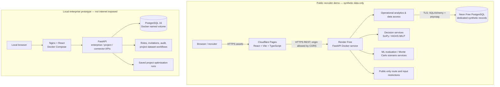
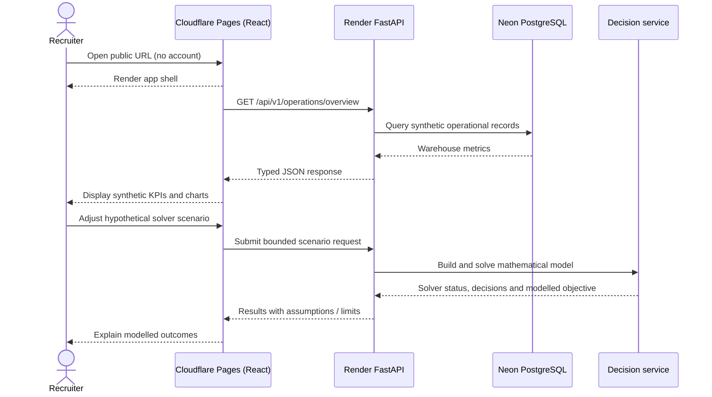
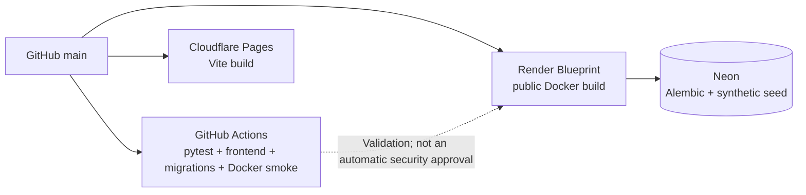

# OpsIntelligence — System Architecture

**Scope:** Architecture of the deployed *synthetic public demo* and the separate *local enterprise prototype*. Updated after public deployment on 22 November 2026. This document describes implemented interfaces and clearly labels security and scaling limitations.

## 1. Architecture at a glance



The public and local profiles use the same codebase with different environment configuration and router exposure. **The public Neon database is separate from the local Acme Logistics project dataset** and is not meant to contain imported company records, accounts or invitation codes.

## 2. Component responsibilities

| Component | Responsibility | Design / operational boundary |
| --- | --- | --- |
| React/Vite UI | Navigation, operations dashboard, orders explorer, industry lab, scenario inputs and rendered results | Browser receives only public API address; never database credentials |
| FastAPI | Typed HTTP contracts, settings, input validation, CORS, route gating and orchestration of analytics/decision services | Public mode removes enterprise and private project routers; middleware additionally denies enterprise paths |
| Analytics services | Aggregate and query synthetic operational records | Dataset statistics describe demonstration data, not a real business |
| Optimisation | Assemble bounded MILP formulations, invoke SciPy/HiGHS and report solver outcomes | Optimality relates only to explicitly encoded choices and constraints |
| ML / simulation | Evaluate classification metrics and execute Monte Carlo scenario comparisons | Models are exploratory and outputs are not validated real-world forecasts |
| PostgreSQL | Persistent operational entities and migration-managed schemas | Cloud database holds a separate public dataset; local DB volume retains enterprise data |
| GitHub Actions | Backend and frontend checks, migration testing and Docker smoke tests | CI does not certify production-scale performance, model fairness or threat resistance |

Source locations: `frontend/src/`, `backend/app/api/`, `backend/app/services/`, `backend/alembic/`, `.github/workflows/ci.yml`, `render.yaml`, and `backend/Dockerfile.public`.

## 3. Public request/data flow



The live demonstration has shown 240 synthetic orders, 68 pending orders, 172 delivered orders and an 81.98% on-time rate at the time of verification. This is a **dataset snapshot**, not a customer impact metric.

## 4. Local private enterprise workflow

The local-only application extends the demo foundation with organisation and employee registration/invitation workflows, role-based authorisation, project/organisation data isolation, bounded CSV validation/import, analytics and saved project optimisation runs. The private optimiser includes provenance (dataset fingerprint, model version and decisions) and a dispatch/defer model for pending orders subject to capacity and hypothetical defer penalties.

These controls are a **portfolio engineering prototype**: they demonstrate server-side access checks, invitation expiry, hashed codes, audit trails and role-management safeguards, but do not represent certified multi-tenant SaaS security. The public site intentionally does not serve enterprise login, connectors or private project data endpoints.

## 5. Public deployment configuration

```text
Browser URL:      https://opsintelligence.pages.dev
Frontend host:    Cloudflare Pages (GitHub-connected Vite production build)
API base URL:     https://opsintelligence-public-api.onrender.com
Backend host:     Render Free (Dockerfile.public)
Database host:    Neon PostgreSQL Free (Sydney project)
```

Public client build variables:

```text
VITE_PUBLIC_DEMO_ONLY=true
VITE_API_BASE_URL=https://opsintelligence-public-api.onrender.com
```

Public backend settings (real database URL must be entered as a *secret*, never committed):

```text
OPS_PUBLIC_DEMO_ONLY=true
CORS_ORIGINS=["https://opsintelligence.pages.dev"]
DATABASE_URL=<private Neon psycopg SQLAlchemy connection URL>
```

The application startup pipeline uses Alembic migrations and seeds bounded synthetic data into the dedicated public database. Startup rejects deployments where public-demo-only mode is not enabled. Credentials are only configured on the backend host.

**Limits:** Render's free service may spin down and have a slow first request. Free-tier RAM/CPU capacity, solver execution time, database quotas, build quotas and billing/acceptable-use limits must be observed. Client-side CORS is not authentication or a firewall; the backend must reject routes and invalid input independently.

## 6. Trust and security boundaries

1. **Browser → frontend:** React/Vite bundles and public Vite build variables are visible to users. Never place database passwords or API secrets in `VITE_*` fields.
2. **Frontend → API:** HTTPS REST; CORS origin restricted to Pages deployment. HTTP clients outside browsers can still call the API, so server-side validation and route restrictions are necessary.
3. **API → database:** SQLAlchemy/psycopg over TLS with a private `DATABASE_URL`, schema migrations and bounded public data.
4. **Public ↔ enterprise:** `OPS_PUBLIC_DEMO_ONLY` prevents mounting enterprise, connector and private project-data APIs; request middleware denies enterprise paths and reseeding. Verified browser response: `Enterprise APIs are not deployed on this public demo`.
5. **Abuse and reliability:** A process-local rate budget for writes is an elementary guard, not distributed rate limiting. No verified penetration test, production-grade MFA, email ownership checks, WAF policy, DDoS hardening or high-availability SLA is claimed.

## 7. Mathematical and data contracts

- Warehouse optimisation models a *specific objective and constraints*, not all decisions across an arbitrary enterprise.
- Industry pilot solvers (logistics, agriculture, technology) are **small assignment MILPs**, not production industry optimisers.
- The public catalogue lists historical third-party datasets as **research references**; they are not automatically ingested into this live demo.
- Modelled cost differences depend on assumed penalties; report them as *hypothetical model improvements*, never realised profit or saved operating costs.
- ML metrics must be disclosed even when model performance is weak. AUC/F1 scores on synthetic experiments do not establish operating reliability.

## 8. Delivery, testing and verification



At the public-deployment milestone, local verification reported **64 passing backend tests**, **21 passing frontend tests**, and passing ESLint/build commands. GitHub PR #9 passed eight CI checks. Browser checks confirmed rendered synthetic KPIs and public API route blocking. Run tests and browser checks again whenever release code changes.

## 9. Trade-offs and future extensions

**Why this architecture:** A single FastAPI service, PostgreSQL and modular Python decision components are understandable, testable and sufficient for bounded demos. Splitting the system into microservices now would increase operational complexity without demonstrated need. Separating public and local enterprise profiles prevents untested business-account functionality from being internet exposed.

**Future, not yet implemented as production features:** stronger tenant isolation and identity verification, validated live connectors, job queues and optimisation timeouts, provenance dashboards, regional adapters, model monitoring and regression backtests, tracing and alerting, horizontally scalable solver workers, and independently verified security testing.

See the [README](../README.md), [public verification checklist](public-deployment-verification.md) and [release guide](public-zero-cost-deployment.md).
